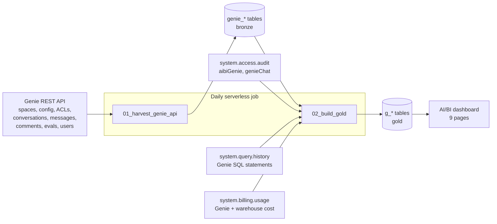
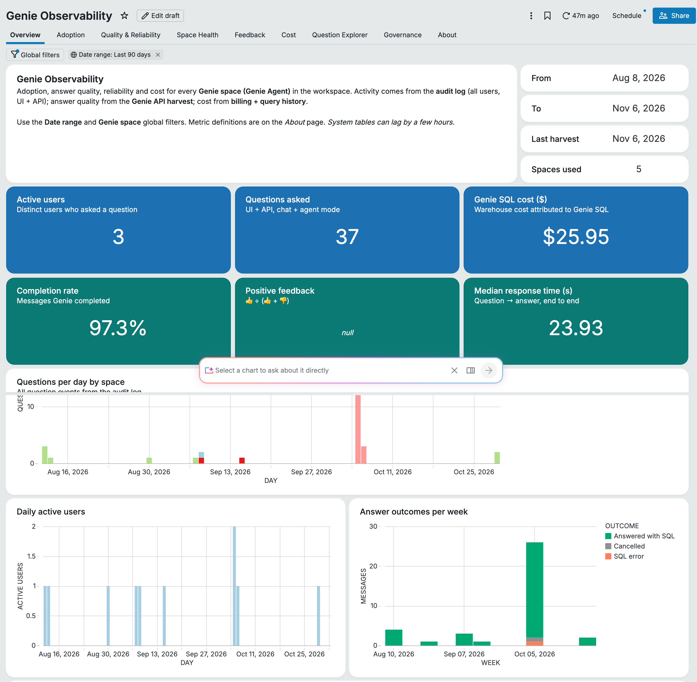
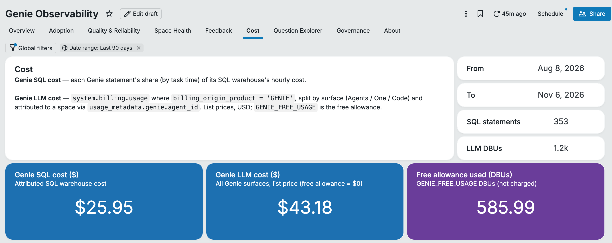

# Genie Observability

A Databricks Asset Bundle that gathers usage, quality, configuration and cost metrics for **Genie spaces (Genie Agents)** and **Genie One** into Unity Catalog. It also ships a 9-page AI/BI dashboard. You can deploy it to any workspace with a single command.





<details><summary>Cost page</summary>


</details>

*Screenshots from a demo workspace with light Genie usage.*

## Deploy (5 minutes)

### 1. Prerequisites
- Databricks CLI **≥ 0.281** (`databricks -v`)
- A Unity Catalog **catalog** where you can create a schema
- A **SQL warehouse** (serverless recommended) for the dashboard
- `SELECT` on `system.access.audit`, `system.query.history`, `system.billing.usage` and `system.billing.list_prices`
- Ideally workspace admin, or CAN MANAGE on the Genie spaces you want covered (see [Who should the job run as?](#who-should-the-job-run-as))

### 2. Get the code and log in
```bash
git clone https://github.com/rabijaved/genie-observability.git && cd genie-observability
databricks auth login --host https://<your-workspace-url> --profile myws
```

### 3. Find your IDs
| Value | Where to find it |
|---|---|
| `catalog` | **Catalog** explorer, or `databricks catalogs list -p myws` |
| `warehouse_id` | **SQL Warehouses** → your warehouse → *Overview* → **ID**, or `databricks warehouses list -p myws` |
| `schema` *(optional)* | Any name; the job creates it. Default `genie_observability` |

### 4. Configure (pick one)
`databricks.yml` holds no workspace-specific values. The workspace comes from your CLI profile (`-p myws`). Supply the rest in one of these ways:

**a) Command-line flags**
```bash
databricks bundle deploy -t prod -p myws --var catalog=main --var warehouse_id=1234abcd5678efgh
```

**b) Environment variables**
```bash
export BUNDLE_VAR_catalog=main BUNDLE_VAR_warehouse_id=1234abcd5678efgh
databricks bundle deploy -t prod -p myws
```

**c) Overrides file**, kept locally and never committed (`.databricks/` is git-ignored). You set it once, and every later command picks it up:
```bash
mkdir -p .databricks/bundle/prod
cat > .databricks/bundle/prod/variable-overrides.json <<'JSON'
{ "catalog": "main", "warehouse_id": "1234abcd5678efgh", "schema": "genie_observability" }
JSON
databricks bundle deploy -t prod -p myws
```

### 5. Deploy and run
```bash
databricks bundle validate -t prod -p myws
databricks bundle deploy   -t prod -p myws
databricks bundle run genie_observability_job -t prod -p myws   # first run = full backfill (minutes)
databricks bundle summary  -t prod -p myws                      # shows the dashboard URL
```

Targets:
- **`dev`** (default): resources are prefixed `[dev <you>]` and the schedule is paused. Use it to try things out.
- **`prod`**: stable names, and the job runs daily at 02:00 UTC on serverless compute.

The deploy creates:
- the job **Genie Observability — harvest & gold refresh**
- the dashboard **Genie Observability**, reading from `${catalog}.${schema}`

| Variable | Required | Default | Meaning |
|---|---|---|---|
| `catalog` | ✅ | – | Catalog for all tables |
| `warehouse_id` | ✅ | – | Warehouse the dashboard runs on |
| `schema` | | `genie_observability` | Schema the job writes to and the dashboard reads from |
| `lookback_days` | | `7` | Incremental runs re-read conversations created in the last N days |
| `system_lookback_days` | | `180` | History pulled from system tables |
| `schedule_pause_status` | | `UNPAUSED` | `PAUSED` disables the daily schedule |

To run the job as a service principal, uncomment `run_as` under the `prod` target in `databricks.yml`.

**No CLI?** Import `src/01_harvest_genie_api.py` and `src/02_build_gold.py` as notebooks, then run them in order with widgets `catalog` and `schema`. Next, import `src/dashboards/genie_observability.lvdash.json` and set the dashboard's default catalog and schema.

### Who should the job run as?
The Genie API only returns other users' conversations when the caller has **CAN MANAGE** on the space (`include_all=true`). Run the job as a workspace admin, or as a service principal that has CAN MANAGE on the spaces (for example, through the parent folder). Where the principal lacks that access, the harvest falls back to the principal's own conversations. The *Harvest scope* column and health flag show this. Audit-based metrics (active users, questions, feedback, lifecycle) always cover **every user**.

### Multiple workspaces
Every table has a `workspace_id` column. Deploy the bundle in each workspace and point every deployment at the same `catalog.schema`, which must be reachable from all of them. The gold step covers every workspace that has written to `genie_harvest_log`.

## What you get

### Bronze (API harvest)
| Table | Grain | Highlights |
|---|---|---|
| `genie_spaces` | space | title, warehouse, folder, **config maturity** counts (tables, column configs, entity matching, instructions + chars, example SQL, SQL functions, join specs, snippets, sample questions, benchmarks), full `serialized_space`, harvest scope |
| `genie_space_tables` | space × table | tables attached to each space |
| `genie_space_acl` | space × principal | permission level, inherited |
| `genie_conversations` | conversation | title, agent type (chat / agent mode), starter |
| `genie_messages` | message | question, status, response time, SQL + all statement IDs, row count, text answer, clarification flag, suggested questions, viz flag, error, feedback, **thoughts + data sources Genie used**, raw JSON |
| `genie_comments` | comment | review requests / comments (Public Preview API) |
| `genie_eval_runs` / `genie_eval_results` | run / question | benchmark accuracy, per-question assessment, expected vs actual SQL (Beta API) |
| `genie_users` | principal | numeric user_id → email / SP |
| `genie_harvest_log` | run | counts, live space IDs (marks trashed spaces) |

### Gold (rebuilt daily)
| Table | Highlights |
|---|---|
| `g_audit_events` | about 25 categorised Genie and Genie One event types (question, agent-mode question, feedback, review request, share, export, delete, regenerate, cancel, space create/clone/trash/config change, benchmark run, Genie One question/tool call/scheduled task), UI vs API channel, email |
| `g_query_stats` | every Genie SQL statement: latency breakdown, rows/bytes, failures, cache hits, identity, **warehouse cost attributed per statement** (task-time share of each warehouse-hour) |
| `g_genie_billing` | Genie LLM consumption by surface (GENIE_AGENTS / GENIE_ONE / GENIE_CODE), channel, **space** (`usage_metadata.genie.agent_id`), user, free vs billable |
| `g_messages` | one enriched row per question: outcome, LLM-reasoning vs SQL time, SQL cost, feedback (API or audit), review requests |
| `g_feedback` | one row per rated answer: **latest 👍/👎 per rater per answer**. Ratings are normalised across UI (`THUMBS_UP/DOWN`), API (`POSITIVE/NEGATIVE/NONE`) and Genie One (`ONE_CHAT_FEEDBACK_RATING_*`), then joined to the rated question, outcome, latency and SQL, plus rating changes and time to feedback |
| `g_space_scorecard` | per space: config score 0-100, reach vs adoption, 30-day questions/users/quality/latency/cost, latest benchmark accuracy, creator, **health flags** |
| `g_table_usage` | attached tables vs tables Genie actually sourced from (90 days) |
| `g_eval_runs` | benchmark accuracy trend |

### Dashboard pages
Overview · Adoption · Quality & Reliability · Space Health · **Feedback** (👍/👎 volume, positive rate and coverage, by space/outcome/latency/turn/surface, raters, 👎 and 👍 answer lists) · Cost · Question Explorer · Governance · About (definitions and data freshness). Global filters: **Date range** and **Genie space**.

To change the dashboard, edit `src/dashboards/build_dashboard.py`, run `python src/dashboards/build_dashboard.py`, then run `databricks bundle deploy`.

## Notes and caveats
- **PII**: user-typed text, Genie answers and identities are stored in `genie_messages` (`question`, `sql`, `text_response`, **`raw_json`**, the full API payload), `genie_comments` (`content`, `raw_json`), `genie_eval_results` (SQL), `genie_users` (email of every asker), `genie_space_acl`, and the gold tables `g_messages`, `g_feedback`, `g_audit_events` (emails). The Question Explorer and Feedback pages surface them. Apply column masks or restrict the schema and dashboard as needed. The dashboard is published **without embedded credentials**, so viewers need SELECT on the schema.
- **Cost** uses list prices (`pricing.effective_list.default`), not negotiated discounts. SQL warehouse cost is an allocation by task time.
- Genie free usage (`GENIE_FREE_USAGE`) appears in billing from 2026-07-20. Earlier free usage isn't recorded.
- The conversation list endpoint returns no `last_updated` field. Each incremental run re-reads messages for new conversations, conversations created in the last `lookback_days`, and conversations with in-flight messages. Run with `full_refresh=true` occasionally to pick up very late follow-ups.
- **Failure handling**: if listing spaces fails, the job aborts before writing anything. If one space's details, ACL or conversation list fails transiently, that space keeps its previous rows. Conversations that fail are skipped and retried on the next run. The harvest task fails, after writing what succeeded, if more than 5% of items failed. `genie_harvest_log.n_failures` records the count.
- **Feedback** counts each rater's latest 👍/👎 per answer (a withdrawn rating counts as none), so a message rated by two people counts twice. The API's single per-message rating is only used when the audit log has no rating for that message.
- **Adoption rate** is blank for spaces shared via groups, because group membership is not expanded.
- Comments and eval endpoints are Preview/Beta. Turn them off with the `harvest_comments` / `harvest_evals` widgets if they change.
- Each workspace can hold up to 200,000 conversations per space. Conversations users delete disappear from the API but stay in these tables.

## Acknowledgements
Ideas and metric definitions were drawn from community Genie monitoring notebooks and dashboards shared by Databricks field engineers. This version adds audit, billing and query-history joins, space configuration and benchmark harvesting, feedback analytics and a deployable bundle.
